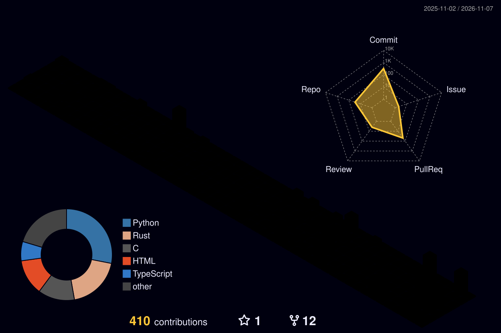

<!-- ░░ HEADER ░░ -->


<p align="center">
  
</p>

<p align="center">
  <a href="https://git.io/typing-svg">
    
  </a>
</p>

<p align="center">
  
  <a href="https://github.com/cyberknight-cmd?tab=followers"></a>
  
</p>

---

### `> whoami`

```c
struct Developer arya = {
    .alias        = "CyberKnight",
    .location     = "India 🇮🇳",
    .working_on   = "my own Operating System",
    .learning     = { "Data Structures & Algorithms", "Low-level Systems" },
    .exploring    = { "AI", "Machine Learning", "Robotics" },
    .passionate   = { "open-source", "building impactful tools" },
    .fuel         = "caffeine (perpetually full)",
    .goal         = "be remembered as one of the greatest developers ever",
};
```

### ✨ About Me

I spend my days breaking things apart to see what secrets they hide, only to realise everything is emptier than I thought – except my caffeine cup, which is perpetually full. I break things for fun and fix them out of guilt. From building pointless OS projects no one asked for to teaching machines how to think (so they can replace us faster), I live somewhere between logic, endless pointer calculations, and existential dread. I write code that works… eventually. If something isn’t broken, give me a minute – after all, bugs are life’s way of keeping me *entertained*.

---

### ⚡ Tech Arsenal

<p align="center">
  <a href="https://skillicons.dev">
    <br/>
    <br/>
    
  </a>
</p>

<details>
  <summary><h2 style="color: #F75590;">🛠️ The Full Toolbox (click to expand)</h2></summary>

  <br>

  <h3>💻 Programming and Markup Languages</h3>
  <br>
  <p align="center">
    
    
    
    
    
    
    
    
    
    
    
    
    
    
    
  </p>

  <br>

  <h3>🧰 Frameworks and Libraries</h3>
  <br>
  <p align="center">
    
    
    
    
    
    
    
    
    
  </p>

  <br>

  <h3>🗄️ Databases and Cloud Hosting</h3>
  <br>
  <p align="center">
    
    
    
    
    
  </p>

  <br>

  <h3>💻 Software and Tools</h3>
  <br>
  <p align="center">
    
    
    
    
    
    
    
    
    
    
    
    
    
    
  </p>

</details>

---

### 📌 Featured Work

| Project | What it is |
| :-- | :-- |
| [](https://github.com/CyberKnight-cmd/memforge) | 🧠 Interactive OS lab — memory allocation, fragmentation, paging & page-replacement algorithms. *(C)* |
| [](https://github.com/CyberKnight-cmd/ulai) | 📦 One file, double-click, any distro — signed & sandboxed Linux apps (AppImage superset, Landlock). *(Rust, pre-alpha)* |
| [](https://github.com/CyberKnight-cmd/echo) | 🚦 Hierarchical Stackelberg-game framework for scalable autonomous intersection management. *(C++)* |
| [](https://github.com/CyberKnight-cmd/zivak) | 🩺 Zero-Inference Validated AI for knowledge-grounded diagnostics. *(Python)* |
| [](https://github.com/CyberKnight-cmd/amazon-ml-challenge-2026-entity-resolution) | 🔗 Entity resolution across noisy sources — blocking + LightGBM matcher + context decoder. |
| [](https://github.com/CyberKnight-cmd/odoo) | 🏆 **2nd Runner-Up** — carpooling platform with Uber H3 geospatial route matching, JWT & REST. |
| [](https://github.com/CyberKnight-cmd/INSANE-PROJECTS) | 💡 From-scratch projects reinventing the wheel to master how it turns — logic-first, library-last. |
| [](https://github.com/CyberKnight-cmd/git-drive) | ☁️ Git-inspired backup utility that syncs local changes to Google Drive. *(Python)* |
| [](https://github.com/CyberKnight-cmd/dsa-overall) | 📚 Topic-wise DSA practice in C++/Java plus LeetCode solutions. |

---

### 📊 Stats & Activity

<p align="center">
  
  
</p>

<p align="center">
  
</p>

<p align="center">
  <picture>
    <source media="(prefers-color-scheme: light)" srcset="./profile-3d-contrib/profile-gitblue.svg" />
    
  </picture>
</p>

<p align="center"><sub><b>Note:</b> Top languages only reflects my public code — not experience or skill level.</sub></p>

<p align="center">
  <picture>
    <source media="(prefers-color-scheme: dark)" srcset="https://raw.githubusercontent.com/cyberknight-cmd/cyberknight-cmd/output/github-contribution-grid-snake-dark.svg" />
    
  </picture>
</p>

---

<h3 align="center">📫 Connect with me</h3>
<p align="center">
  <a href="mailto:aryagupta164@gmail.com"></a>
  <a href="https://dev.to/cyberknight-cmd"></a>
  <a href="https://twitter.com/cyberknight_cmd"></a>
  <a href="https://linkedin.com/in/aryagupta2304"></a>
  <a href="https://instagram.com/cyberknight_ig"></a>
  <a href="https://www.hackerrank.com/aryagupta164"></a>
  <a href="https://codeforces.com/profile/cyberknight_cmd"></a>
  <a href="https://www.leetcode.com/arya2024"></a>
</p>

<p align="center"><i>“It works on my machine.” — me, shipping it anyway.</i></p>


